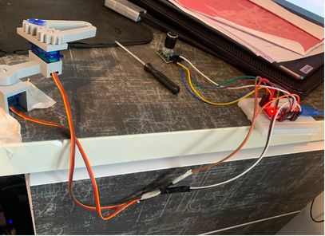

# Envelope Delivery System

A servo-driven mechanism that retrieves envelopes from a high shelf, so nothing has to be reached for by hand. A geared arm collects an envelope in a gripper, lowers it to an accessible position, releases it, and returns for the next one. It is controlled with a single rotary encoder and runs on an Arduino Nano.

**Demo video:** [Watch the demo](docs/envelopeDemo.MOV)



---

## How it works

The system has two servos: an **arm** servo (Servo 1) that swings the envelope away from the shelf, and a **gripper** servo (Servo 2) that holds and releases it. A rotary encoder with a push button controls both.

**Manual control.** Rotating the encoder moves the selected servo in 5° steps (limited to 0° to 180°). A single click of the button switches the encoder between Servo 1 and Servo 2. This is used to position the arm, calibrate the gripper, and troubleshoot.

**Automatic delivery sequence.** Once an envelope is loaded and the gripper is closed on it:

1. **Double click:** delivery starts. The arm moves to 0° one degree at a time (15 ms per degree) so the motion stays smooth, pauses for half a second, then the gripper opens to 90° to release the envelope.
2. **Double click again:** return starts. The arm moves back to 180° one degree at a time.
3. **Single click:** the gripper closes (180°), ready for the next envelope to be loaded.

Status messages are printed to the Serial Monitor at 9600 baud.

## Controls

| Input | Action |
|---|---|
| Rotate encoder | Move the selected servo by 5° per click (0° to 180°) |
| Single click | Switch the encoder between Servo 1 (arm) and Servo 2 (gripper) |
| Double click (at rest) | Run the delivery sequence |
| Double click (after delivery) | Start the return sequence |
| Single click (after return) | Finish the return and close the gripper |

A double click is two presses within 400 ms.

## Hardware

- Arduino Nano
- 2× hobby servos
- Rotary encoder with push button
- 3D-printed gripper, gear mechanism and housings (PLA), from my own CAD designs
- Screws to mount it to the shelf

The wiring schematic is in `docs/schematic.jpg`.

### Pin map

| Component | Pin |
|---|---|
| Encoder CLK | 2 |
| Encoder DT | 3 |
| Encoder switch (SW) | 4 |
| Servo 1 (arm) | 9 |
| Servo 2 (gripper) | 10 |

## Setup

1. Open `envelope_delivery.ino` in the Arduino IDE. 
2. The code uses the built-in `Servo` library.
3. Wire the hardware following the pin map above.
4. Upload, then open the Serial Monitor at 9600 baud.
5. Use manual control to move the arm to its shelf position and set the gripper before running the sequence.

## Design notes

- **Geared mechanism.** The gears were modelled in Fusion 360. I checked alignment, spacing and gear meshing using motion animations before printing.
- **Gripper preload.** The gripper was calibrated to close on the envelope at about 170°, while the servo is commanded to 180°. The difference keeps the servo applying pressure on the envelope, which reduces slipping.
- **Smooth arm movement.** The arm moves in single-degree steps rather than jumping between positions, which gives smoother motion and fewer sudden movements.
- **Print orientation.** The support rod for the second gear arm is printed with its layers perpendicular to the applied force, to reduce the risk of snapping under load.

## Limitations

- The system is open loop. There is no sensor to confirm that an envelope is held or has been released.
- Loading the next envelope is still done by hand.
- The encoder is not read while the arm is moving, because the movement runs as a blocking loop.

## Possible improvements

- Automate loading.
- Add a sensor to detect whether an envelope is gripped.
- Move the gripper smoothly as well, rather than directly to its end positions.

## Repository contents

```
envelope_delivery.ino   Arduino firmware
docs/                   Photos, schematic, CAD drawings
```


Part of my MIT Maker Portfolio. Built by Rodryk Carvalho.
